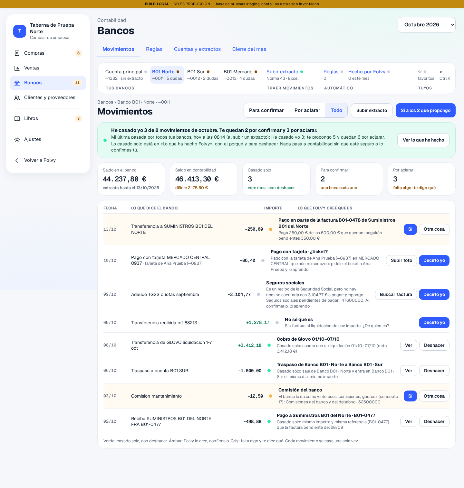
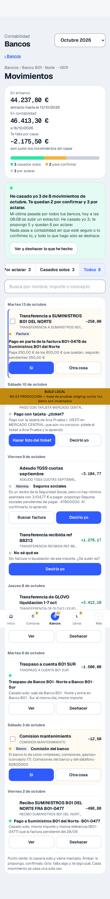
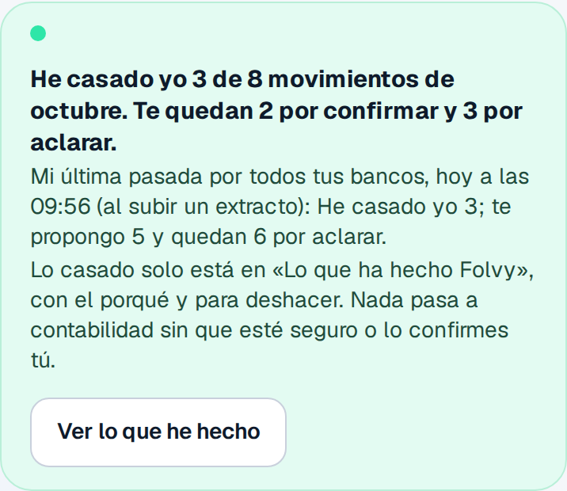
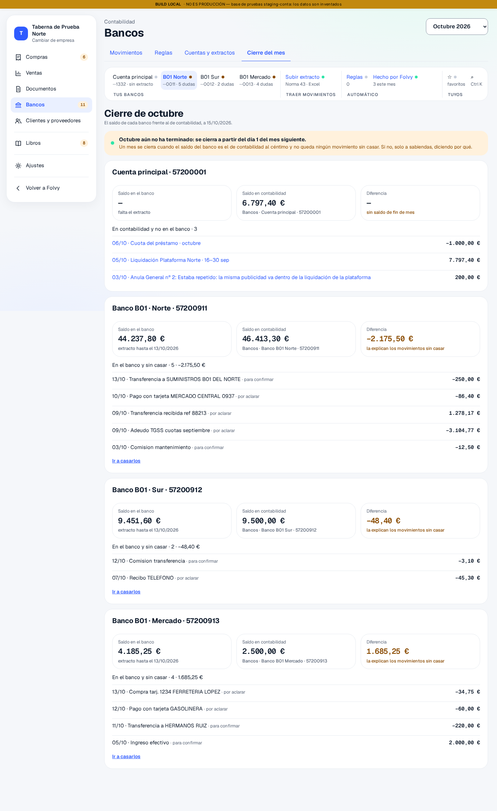
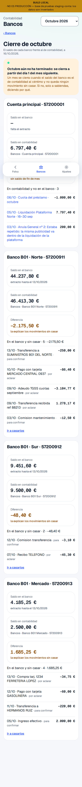

# B01 · Parte de la tarea 6, parado antes de la 7

Rama `conta/b01-bancos`. Respuesta 4 de Julio (13/10/2026): «Sigue con la tarea
6 después de los retoques… Para antes de la 7 con capturas de ordenador y móvil
del cierre del mes, de la banda del agente y de los retoques del punto 2.»
Todo con datos inventados.

## 0. `main` traído

C fusionó los usuarios de prueba por frente (#179), y la respuesta 3 pedía traer
`main` entonces. Fusionado en la rama (86 commits). Cuatro conflictos, resueltos así:

| Fichero | Cómo |
|---|---|
| `.github/workflows/e2e-staging-conta.yml` | el de `main` entero. Trae su propia entrada `pruebas` (lo mismo que mi `ruta`, más el frente y el cerrojo de staging): **mi `ruta` desaparece** |
| `src/modules/conta/services/propuestasLibroService.ts` | los dos: la serie de tesorería (B01) y la regla de ventas por plataforma (C04b) |
| `docs/conta/contraste.md` | las dos secciones (Bancos y el anexo de Diez) |
| `supabase/staging/aplicar.txt` | el de `main` (lo reescribe la tanda siguiente) |

Con los usuarios por frente, mi rama entra como `a.admin.frente-b@…` (la misma
cuenta A): mis e2e no tocan la contraseña de nadie más.

## 1. Retoques de la respuesta 4

| Punto | Hecho |
|---|---|
| 1 · Barra en una fila | Nombre corto de cada banco (`treasury_account.short_name`, editable en Cuentas y extractos con `bank_cuenta_alias`; la semilla pone «B01 Norte», «B01 Sur», «B01 Mercado»). Hasta cuatro bancos, todos; desde cinco, tres a la vista —el de más dudas y el elegido siempre— y «y N más», que abre la lista. La e2e mide que los cuatro grupos están en la misma fila. Libros, sin tocar |
| 2.1 · La barra de la IA tapaba una fila | En Bancos no se enseña: `MarcoConta` tiene `sinPregunta` (y en el móvil quita el botón central de la IA, no la barra de navegación). Fichero compartido del C00, cambio pequeño. El hueco del final ya estaba (`.cx-principal`, 104 px) |
| 2.2 · «Conectar · pronto» | Fuera. Vuelve cuando exista el contrato del agregador |
| 2.3 · Un solo botón principal | Ámbar: «Sí» (o «Subir foto» si falta el ticket). Gris: «Decirlo yo». Verde: ninguno, «Ver» y «Deshacer» en secundario. Lo decide el núcleo (`filaDe().principal`) y lo prueba la e2e |
| 2.4 · Migas | «Bancos › Banco B01 · Norte · ···0011» |
| 2.5 · El «difiere» de staging | La semilla lleva el asiento de apertura de cada banco a 30/09 (propuesto, origen `opening`, que el cierre ya no cuenta como «en contabilidad y no en el banco»). Ahora la diferencia de Norte es **exactamente** lo que queda sin casar (−2.175,50 €) y la pantalla lo dice |
| 2.6 · Móvil al lado del ordenador | En §5 |

## 2. Las reglas (respuesta 4, punto 3)

1. **Lo que sale de una regla o de lo aprendido es siempre probable.** Ya lo
   era: el motor no da «seguro» por una regla ni por lo aprendido en ningún
   caso, ni con la regla confirmada (seguro solo sale de los casos con
   pareja exacta: factura con referencia, traspaso, liquidación, cuota,
   asiento ya apuntado). Es más estricto que lo pedido; lo dejo así y lo
   prueba `agregadorB01.test.ts` («una regla propone, nunca casa sola»).
2. **Dos correcciones la apagan.** En la base: cuando la persona casa con otra
   cosa lo que proponía una regla (`bank_casar`), es una corrección
   (`bank_rule.corrections`); a la segunda, la regla pasa a «apagada», queda en
   su registro y en «Lo que ha hecho Folvy»: «He apagado la regla «…»: la has
   corregido dos veces. Puedes volver a encenderla en Reglas.». Un «Sí» a lo
   que propone no cuenta. Probado en staging (paso 2 de la prueba nueva).

## 3. Tarea 6

### 3.1 Agente «Conciliación»

Tiene dos partes, porque una casa y la otra vigila:

- **La que casa** es el motor de siempre, con sus guardas: nada se valida fuera
  de «validar solo lo seguro» de la empresa. Corre **después de cada extracto**
  (Subir extracto) y **una vez al día**: si hoy no ha pasado, la primera vez que
  alguien abre Bancos. Cada pasada queda en `bank_agent_run` con su resumen, y
  ese resumen sale en la banda verde («Mi última pasada por todos tus bancos,
  hoy a las 02:30 (al subir un extracto): He casado yo 3; te propongo 5 y
  quedan 6 por aclarar.») y en «Lo que ha hecho Folvy». La pasada es de la
  empresa entera y el titular de la banda es del banco elegido: por eso lo dice
  (§5, lo que vi en las capturas).
- **La que vigila** corre cada noche con los demás agentes, en solo lectura
  (`scripts/conta/agente-conciliacion.sql`, `lib/conciliacion.mjs`; en staging
  y en producción). Mira lo del encargo: nada casado dos veces, ningún asiento de
  Bancos sin movimiento, los meses cerrados siguen cuadrando, reglas con su
  registro, extractos que cuadran; y lo nuevo: permisos del agregador caducados o
  por caducar, y movimientos sin mirar sin pasada del agente en 48 h. Sobre el
  volcado real de staging dice, con razón, una sola cosa en ámbar: 15
  movimientos sin mirar y ninguna pasada (las e2e lo deshacen todo al acabar).

**Lo que no es exactamente lo pedido, y lo digo:** «una vez al día» depende de
que alguien abra Bancos ese día, porque el motor corre en la app con los
permisos de la persona (las funciones comprueban que es administrador o
encargado de la cuenta). Si nadie entra, no pasa; y lo caza el agente de la
noche («sin pasada», en ámbar). Hacerlo sin nadie delante pide una función del
servidor con identidad propia (una edge function con su cron) y que las
funciones del banco acepten esa identidad: es un cambio de seguridad y lo
decides tú. **¿Lo quieres para la tarea 7?**

### 3.2 Cierre del mes del banco

- `bank_mes_cerrar(banco, mes, a_sabiendas, porqué)`: el mes en curso no se
  cierra; con movimientos sin casar, sin el saldo de fin de mes o con
  diferencia, **no**, salvo a sabiendas y con su porqué, que queda escrito con el
  nombre de quien cerró; el mismo mes dos veces, no. `bank_mes_reabrir` pide
  porqué. Cada cosa, en «Lo que ha hecho Folvy».
- La pantalla enseña lo que calcula la base (`bank_meses_estado`), el mismo
  estado que comprueba el cierre: saldo del banco, de contabilidad, la
  diferencia y la lista que la explica (en el banco sin casar · en contabilidad
  y no en el banco). Botones: «Cerrar octubre» cuando cuadra, «Cerrar a
  sabiendas…» cuando no, «Reabrir…» si está cerrado.
- Staging no tiene un mes terminado con datos (todo es de octubre): la captura
  enseña octubre «aún no ha terminado». El cierre de un mes terminado lo prueba
  la prueba de staging (paso 3): septiembre de Mercado con un recibo sin casar →
  no; a sabiendas sin porqué → no; con porqué → sí (2.400 / 2.500 / −100 y 1
  suelto); dos veces → no; reabrir; casado el recibo → cierra igual al céntimo.

### 3.3 Agregador (sin pantalla)

- **Enable Banking**: `proveedorEnableBanking(transporte)` cumple la interfaz de
  siempre (`ProveedorAgregador`). La llamada firmada (la clave de la aplicación)
  se inyecta: aquí no hay claves ni red. Su transacción se pasa a nuestro modelo
  en **una sola función** (`movimientoDeEnableBanking`): si al firmar algún campo
  cambia, se cambia solo ahí. Páginas con `continuation_key`, solo lo
  contabilizado. Los nombres de campo salen de su esquema publicado
  ([referencia](https://api.enablebanking.com/), [esquema](https://apis.io/schemas/enable-banking/enable-banking-transaction/)); no he podido leer su documentación entera desde el contenedor.
- **El mismo movimiento por dos caminos**: el agregador no trae las referencias
  del Norma 43, así que la huella entera difiere; la **huella suave** (día,
  importe y orden en el día) coincide. `bank_importar` lo aplica: entre una
  fuente y otra, la suave basta y no entra dos veces; entre dos ficheros, sigue
  preguntando «¿es el mismo?». Probado en staging (paso 5) y con los
  movimientos de la demostración en las unitarias.
- **Consentimiento**: dura 180 días (`caducaElConsentimiento`); 7 días antes
  avisa con cuándo caduca y el clic que lo renueva («Renovar el permiso» y
  confirmas en tu banco). Las conexiones van en `bank_aggregator_link`; el
  agente de la noche avisa en ámbar a 7 días y en rojo si caducó y sigue activo.
  **Nada de esto se ve en pantalla** hasta el contrato.

## 4. Pruebas

| Qué | Dónde | Resultado |
|---|---|---|
| Unitarias del módulo y de los agentes (`tests/unit/modules/conta`, `tests/conta`) | local, 14/10 | **1.457 de 1.457**, 74 ficheros. Nuevas: `agregadorB01.test.ts` (10) y `conciliacion.test.ts` (3, sobre el volcado real de staging) |
| Prueba de staging de la 0150, fichero entero y como usuario (alias, reglas, cierre, agente, agregador, consentimiento, RLS) | run 38476832698 | **7/7** |
| Las de antes (bancos, tarjetas) | mismo aplicador | 13/13 y 7/7, siguen |
| Semilla B01 con las aperturas fechadas a 30/09 | run 38482604756 | aplicada |
| E2e completa de la rama (e5f6a96) | run 38482604754 | **todas las del B01 en verde**. Fallan 4 ajenas, que no toco (abajo) |
| Agente nocturno con el paso nuevo | run 38482604778 | «Conciliación (solo lectura)» e «Informe» en **verde**; «Aviso» y «Resultado» se saltan porque no hubo rojo, como deben. El job sale rojo por «Plan contable» y «Datos maestros» (semillas de otros frentes) |

Lo que diría hoy el agente, consultado a mano en staging (solo lectura):
`movimientos 15 · casados 0 · sin mirar 15 · extractos 6 · reglas 0 · meses
cerrados 0 · pasadas en 48 h 5 · enlaces del agregador 0 · asientos de Bancos
sin movimiento 0 · empresas sin pasada: ninguna`. El ámbar «sin pasada» de la
fixture (13/10) ya no sale porque ahora la e2e deja su pasada registrada.

### Dos fallos que cacé yo, y uno que no es mío

1. **Mis aperturas rompieron la e2e del libro del C04**, en mi rama y en la de
   D01 (run 38476695805). Lo digo para que D01 no lo busque: **ese fallo fue
   mío.** La semilla creaba los tres asientos de apertura con fecha de hoy y
   echaban «Asenté «Ventas del día · Norte Centro»» de los cinco últimos de
   «Lo que he hecho yo». Arreglo: la semilla les pone `created_at` a 30/09.
2. **El paso del agente nocturno no corría**: lo había puesto detrás de
   «Resultado del libro», que sale con `exit 1`. Ahora va delante.
3. **libro.spec del C04 sigue en rojo, pero ya no por mí.** Consulta a staging,
   los asientos de la cuenta A por `coalesce(validated_at, created_at)`:

   | Puesto | Concepto | Estado | Cuándo (UTC) | Quién |
   |---|---|---|---|---|
   | 1 | Ventas del día · Prueba e2e mv7b73ws | propuesto | 13/10 23:25 | Prueba e2e |
   | 2–3 | Ventas Glovo · Norte Centro | propuesto | 13/10 09:52 | Folvy (cierre del día) |
   | 4–7 | Abono y Factura Hermanos Ruiz, Nóminas, Cuota del préstamo | validado | 07–08/10 | Ana Prueba |
   | 11 | **Ventas del día · Norte Centro** (el que busca la prueba) | validado | 07/10 17:13 | Folvy |
   | 13–15 | Saldo inicial del banco · Banco B01 Norte / Sur / Mercado | propuesto | 30/09 06:00 | Semilla B01 |

   Lo desplazan un manual que dejó una e2e sin deshacer y dos «Ventas Glovo»
   del cierre del día. No lo arreglo porque es de C04/C04b; lo aviso.

## 5. Capturas

Todas en `docs/conta/capturas/b01/pantallas/`, de staging-conta con datos
inventados, ordenador 1440 × 900 y móvil 390 × 844, página entera. Primera
tanda: e2e solo del B01, [run 38490328729](https://github.com/Llorente29/llorente29-app/actions/runs/38490328729)
(verde, commit 9415dbc). La segunda (abajo) añade el cierre en el móvil y la
banda corregida.

### 5.1 Movimientos, ordenador y móvil lado a lado (2.6)

| Ordenador | Móvil |
|---|---|
|  |  |

Se ve en las dos los retoques del punto 2:

- **barra en una fila** (2 y 1): «Cuenta principal · B01 Norte · B01 Sur · B01 Mercado», con los nombres cortos y sus dudas;
- **sin «Pregunta o pide algo»** (2.1) ni **«Conectar · pronto»** (2.2);
- **migas** «Bancos › Banco B01 · Norte · ···0011» (2.4);
- **un botón principal por fila** (2.3): «Sí» en ámbar, «Decirlo yo» en gris, ninguno en verde;
- **«difiere 2.175,50 €»** (2.5), que es justo lo que queda sin casar en Norte. El cierre lo desglosa movimiento a movimiento.

En el móvil, la barra de navegación sale **a media imagen**, encima de los saldos.
Es cosa de la captura de página entera: la barra es fija y Playwright la pinta
donde cae la primera pantalla. En el teléfono va abajo, y la e2e mide en cada
captura del móvil que no tapa ninguna fila (`loQueTapan`, en verde).

### 5.2 La banda del agente

| Ordenador | Móvil |
|---|---|
|  |  |

**Lo que vi y he corregido:** la primera tanda decía «Te quedan 2 por confirmar
y 3 por aclarar» en el titular y «te propongo 5 y quedan 6 por aclarar» en la
pasada. Las dos cifras están bien —la primera es de Norte (2 + 3) y la segunda
de los tres bancos (Norte 2 + 3, Sur 1 + 1, Mercado 2 + 2)—, pero leídas juntas
parecen un error. Ahora la pasada dice «Mi última pasada **por todos tus
bancos**, …», y la e2e lo exige.

### 5.3 Cierre del mes

| Ordenador | Móvil |
|---|---|
|  |  |

Las tres diferencias salen exactas y explicadas por lo que queda sin casar:

| Banco | Saldo del banco | Saldo en contabilidad | Diferencia | Sin casar |
|---|---|---|---|---|
| Norte | 44.237,80 € | 46.413,30 € | −2.175,50 € | 5 movimientos, −2.175,50 € |
| Sur | 9.451,60 € | 9.500,00 € | −48,40 € | 2 movimientos, −48,40 € |
| Mercado | 4.185,25 € | 2.500,00 € | 1.685,25 € | 4 movimientos, 1.685,25 € |

En la Cuenta principal (sin extracto de B01) la diferencia sale «—, sin saldo
de fin de mes», con lo que está en contabilidad y no en el banco.

Octubre aún no ha terminado, así que la captura no puede enseñar un mes
cerrado: el cierre de verdad lo ensaya la prueba de staging (§3.2).

### 5.4 Las demás, sin cambios de fondo

Están en la misma carpeta y son las de la tarea 5, ya con la barra en una fila:

- portada, para confirmar y por aclarar (en el móvil);
- por aclarar, tarjeta desconocida, reglas, subir extracto, cuentas y «Lo que ha hecho Folvy» (en el ordenador).

## 6. Ficheros compartidos tocados en esta tanda

| Fichero | Cambio |
|---|---|
| `src/modules/conta/marco/MarcoConta.tsx`, `MenuConta.tsx`, `module.tsx` | `sinPregunta`: una pantalla puede no enseñar la barra «Pregunta o pide algo» ni el botón central de la IA (solo Bancos la usa) |
| `.github/workflows/cumplimiento-nocturno-conta.yml`, `cumplimiento-produccion-conta.yml` | el paso del agente «Conciliación», igual que el del libro |
| `supabase/migrations/20261101T0110_b01_funciones.sql` | (mía, misma tanda) `bank_casar` cuenta la corrección de una regla; `bank_importar` reconoce el mismo movimiento entre fuentes |

## 7. Lo que queda, y lo que te pregunto

1. **¿Pasada diaria en el servidor para la tarea 7?** (§3.1). Hoy la del día
   corre cuando alguien abre Bancos; sin nadie, la caza el agente nocturno en ámbar.
2. **A D01 y C04:** el rojo de libro.spec en el run 38476695805 de D01 fue mío
   (las aperturas) y ya está arreglado. El rojo que queda en libro.spec no es
   mío (§4).
3. **Para la tanda de producción** (tarea 7): 0100–0160 dan «sigue» en el
   analizador. Nada lanzado en producción.
4. Paro aquí, antes de la 7.
