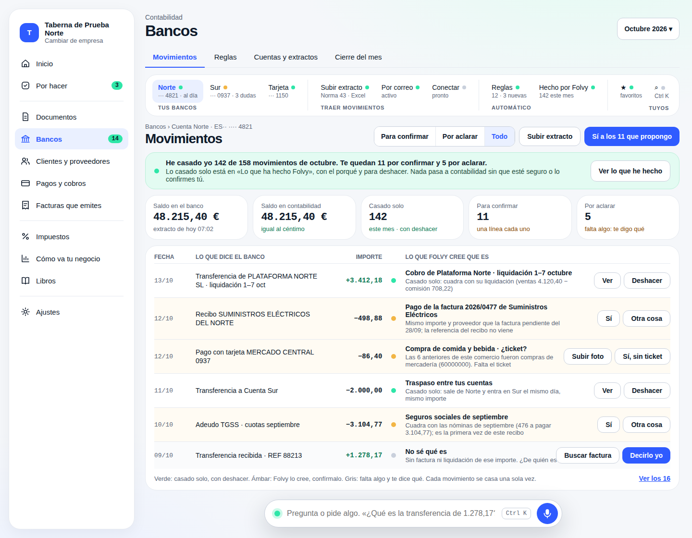

# B01 · Informe final (tarea 7) y tanda para producción, preparada y sin lanzar

Rama `conta/b01-bancos`. Respuesta 5 de Julio (14/10/2026): «Prepara la tarea 7
sin lanzar nada… Para con el informe y la tanda listos. El orden de las tres
tandas lo digo yo, y Julio lanza el ensayo.»

En producción **no he lanzado nada**: todo lo de allí es lectura, con
`execute_sql` de solo `select`. En este documento no hay ningún dato real
(repositorio público): ni importes, ni IBAN, ni nombres de Foodint. Las cifras de
Foodint van en el mensaje a Julio, no aquí.

## 0. Lo de la respuesta 5 antes de la tarea 7

| Punto | Hecho | Prueba |
|---|---|---|
| 1 · Pasada diaria sin nadie delante | No se hace. Queda para el contrato del agregador, con una función del servidor con su propia identidad y tu autorización | — |
| 1 · El agente nocturno solo avisa si hay movimientos sin pasar | Un movimiento está «sin pasar» si entró después de la última pasada del agente de su empresa (o no hay ninguna) y no está casado ni ignorado. Un día sin pasada y sin movimientos nuevos ya no avisa (`scripts/conta/agente-conciliacion.sql`, `lib/conciliacion.mjs`) | Ensayado sobre staging en una consulta de solo lectura que mueve las fechas en memoria: con 30 días sin pasada y nada nuevo, la regla vieja avisaba (1 empresa) y la nueva no (0); con un movimiento entrado después, la nueva avisa (1). Fixture nueva con el volcado real del 14/10; 4 pruebas en verde |
| 2 · Aperturas validadas | La semilla las valida como el administrador de A con el nombre «Semilla B01» (no «Folvy…»: no entran en «Lo que he hecho yo» del C04). Toman los números 3/1, 3/2 y 3/3 de A (la serie 3 de A estaba vacía) | Ensayado antes en una transacción deshecha; aplicado en el run 38519391784; consulta después: las tres `validado`, **0 propuestas del B01 en A** |
| 2 · Nada que cambie lo que ven otros frentes en A y B | Medido en staging: contador de Bancos 0 (las e2e del B01 dejan sus 15 movimientos en «pendiente», que no cuenta), 0 tarjetas vivas, 0 reglas, 0 asientos de Bancos, 0 movimientos en B. Las pruebas de otros frentes sobre A comprueban invariantes (que cuadra, que el 6 y el 7 quedan a cero al regularizar) o cuentas que no toco (la 400 del C02) | Lo que sí queda en A, y solo lo ve Bancos: 6 extractos, 15 movimientos pendientes y el registro de pasadas del agente |

## 1. Informe final

### 1.1 Capturas, ordenador y móvil, frente a N17

Las de la e2e solo del B01 sobre `8ec726b` (run 38502626395, verde) y, con las
aperturas validadas, la del run 38520772178 (§3). Todas en
`docs/conta/capturas/b01/pantallas/`, de staging con datos inventados.

| N17 (maqueta) | Ordenador | Móvil |
|---|---|---|
|  |  |  |

**Igual que N17:** pestañas, barra de grupos (tus bancos · traer movimientos ·
automático · tuyos), migas, segmento «Para confirmar · Por aclarar · Todo»,
«Sí a los N que propongo», la banda verde «He casado yo…», las cinco cifras,
la tabla con sus cuatro columnas y el color por estado, el pie que explica los
colores.

**Distinto de N17, y por qué:**

| Qué | N17 | Ahora | Por qué |
|---|---|---|---|
| Botón principal | Todos en blanco | Uno azul por fila: «Sí» en ámbar, «Decirlo yo» en gris, ninguno en verde | Respuesta 4, punto 2.3 |
| «Por correo», «Conectar · pronto» | Están | No se enseñan | Respuestas 3 y 4: lo que no funciona no se enseña |
| Barra «Pregunta o pide algo» | Flotando sobre la tabla | No está en Bancos | Respuesta 4, punto 2.1: solo diría «Muy pronto» y tapaba una fila |
| Bancos en la barra | Nombre y dudas | Nombre corto («B01 Norte») y dudas; a partir de cinco, «y N más» | Respuesta 4, punto 1 |
| «Ver los 16» | Pagina la tabla | Todas las filas del mes | Regla 7: una pantalla que se abre a propósito no esconde filas |
| La banda | «He casado yo…» | Además, «Mi última pasada por todos tus bancos…» | Tarea 6: el resumen del agente |
| «Saldo en contabilidad … igual al céntimo» | Cuadra | «difiere 2.175,50 €» | Es lo que queda sin casar en staging; el cierre lo explica movimiento a movimiento |
| Menú de la izquierda | El de la maqueta | El del módulo (C00) | No es del B01 |

Las del cierre del mes y la banda del agente, lado a lado:

| Cierre · ordenador | Cierre · móvil | Banda del agente |
|---|---|---|
|  |  | <br> |

Las demás (por aclarar, tarjeta desconocida, reglas, subir extracto, cuentas y
extractos, «Lo que ha hecho Folvy», la portada y las listas del móvil) no tienen
maqueta: están en la misma carpeta y descritas en los partes de las tareas 5 y 6.

### 1.2 Contraste: por encima / igual / por debajo

Contra Diez, Holded, Pennylane, Puzzle, ContaSOL, a3innuva y Sage 50/200 (el
detalle y las fuentes, en `docs/conta/contraste.md`, «Bancos y conciliación»).
«Por encima» solo donde ninguno de los consultados lo hace.

| Pieza | Lo que tienen | Lo que tenemos | Veredicto |
|---|---|---|---|
| Traer el extracto por fichero | N43 (Diez, ContaSOL, a3, Sage), Excel (ContaSOL, a3, Holded) | N43 multicuenta, Excel/CSV de 11 bancos; soltarlo en cualquier pantalla de Bancos; el IBAN se recuerda | Igual |
| Traer el extracto sin fichero | Conexión directa (Holded, Pennylane, ContaSOL, a3innuva, Sage) | Interfaz del agregador (Enable Banking) con proveedor simulado, sin pantalla | **Por debajo** |
| Comprobar el extracto antes de entrar | Sage 200 exige continuidad | Cuadre del fichero, saldo fila a fila, continuidad, huella | Por encima |
| Nada dos veces | Sage 200 avisa al repetir | Huella por movimiento y por fichero; el mismo movimiento por agregador y por N43, uno | Por encima |
| Proponer | Fecha + importe (ContaSOL, a3, Sage, Holded); IA con confianza (Pennylane, Puzzle) | Tres grados con el porqué en una frase | Igual que Pennylane/Puzzle; por encima del resto |
| Hacer solo lo seguro y deshacer | Xero/Puzzle; a3 deshace | Seguro solo con regla escrita; «Lo que ha hecho Folvy» con Deshacer | Igual |
| Aprender y reglas | Pennylane propone reglas; el resto, a mano | Aprende por contraparte, propone la regla en palabras; lo aprendido es siempre probable; dos correcciones la apagan y lo dice | Igual que Pennylane; por encima del resto |
| Cruzar con facturas | Holded, Pennylane, a3, Sage | Recibidas y emitidas, en partes y varias en un pago | Igual |
| Plataformas, préstamos, TGSS, 407 | Diez pone la 430 a mano | Liquidación cuadrada con ventas − comisión; capital e intereses; 476; 407 | Por encima |
| Tarjetas | Pennylane pide el justificante | Tarjeta por sus 4 dígitos, titular y local; «pídele el ticket a…» | Igual en el ticket; por encima en saber a quién |
| Cierre del mes | Diez, a3: saldo y estado | Saldo del banco = 572, o la diferencia movimiento a movimiento; no se cierra con sueltos salvo a sabiendas y con su porqué | Por encima |
| Agente que vigila | — | Cada noche: nada casado dos veces, ningún asiento de Bancos suelto, meses cerrados que siguen cuadrando, reglas con registro, extractos, permisos del agregador, movimientos sin pasar | Por encima |
| Lenguaje | Holded: facturas y movimientos | Nombre · código, sin «subcuenta» | Igual |
| Porcentaje automático | Nadie publica cifra | Ver §1.3 | Sin comparación |

**Lo que está por debajo:** la conexión directa con el banco. Queda la interfaz
lista para Enable Banking, que cobra por cuenta conectada; el presupuesto lo
pides tú. Nada de esto se ve en pantalla hasta que haya contrato.

### 1.3 Lo aprendido, en cifras (producción, Foodint, 2026, solo recuentos)

Sobre 1.943 apuntes de banco de Foodint en 2026 (medidos en la tarea 4,
`docs/conta/B01_informe_tareas_2_4.md` §5):

| | Acierta | Falla | Sin propuesta |
|---|---:|---:|---:|
| Lo aprendido por concepto | 1.455 (**74,9 %**) | 58 (3,0 %) | 430 (**22,1 %**) |
| Más las reglas por contraparte (tarea 5) | 1.595 (82,1 %) | 90 (4,6 %) | 258 (**13,3 %**) |

Aceptado en la respuesta 4 con dos condiciones, hechas: lo que sale de lo
aprendido o de una regla es siempre «probable» (nunca casa solo), y una regla
corregida dos veces se apaga sola y lo dice en «Lo que ha hecho Folvy».

## 2. La tanda para producción (preparada, NO lanzada)

### 2.1 Qué va y en qué orden

**Primero la base, después el front.**

1. **Base** — `supabase/produccion/b01-aplicar.txt` (con su vuelta atrás en
   `supabase/produccion/b01-vuelta-atras.txt` y lo que cuenta antes y después
   en `scripts/conta/produccion/cuentas/bancos.sql`). No está en
   `supabase/produccion/aplicar.txt`, que hoy tiene la tanda del C04b: cuando
   digas el orden, su contenido pasa allí y lanzas el ensayo.

   | Orden | Fichero | Qué hace |
   |---|---|---|
   | 1 | `20261101T0100_b01_bancos.sql` | Las tablas de Bancos, todas nuevas, con RLS |
   | 2 | `20261101T0110_b01_funciones.sql` | Las funciones del motor, nuevas |
   | 3 | `20261101T0120_b01_foodint.sql` | Foodint: serie de tesorería 4, «validar solo lo seguro» apagado, corte el 01/10/2026 |
   | 4 | `20261101T0130_b01_lectura.sql` | Lectura para las pantallas |
   | 5 | `20261101T0140_b01_tarjetas.sql` | Tarjetas de débito e IBAN recordado |
   | 6 | `20261101T0150_b01_cierre_agente.sql` | Cierre del mes, agente, agregador sin pantalla, nombre corto, correcciones de reglas |
   | 7 | `20261101T0160_b01_lectura_agente.sql` | `conta_lectura` lee lo que mira el agente nocturno |
   | 8 | `20261101T0170_b01_foodint_cuentas.sql` | **Nueva, pendiente de tu sí (§2.2)**: las dos fichas de banco que le faltan a Foodint |

2. **Front** — la rama fusionada a `main`, **después** de un real en verde (el
   front lee tablas y funciones que solo existen con la base). La rama no toca
   ninguna edge function y está al día con `main` (0 commits por detrás el
   14/10). Fusionar publica también la web de las tablets. Está hecha cuando
   Vercel dice READY en producción, no cuando está en `main`.

### 2.2 Lo que he medido en producción, solo leyendo — y lo que hay que decidir

**Las tres cuentas bancarias de Foodint.**

| Cuenta | Ficha de banco (`treasury_account`) | IBAN en su ficha | Saldo en el libro a 30/09 |
|---|---|---|---|
| 57200001 | Sí, enlazada como principal (de la migración de Diez) | Sí, español y válido | Medido; todo de lo traído de Diez, validado; nada propuesto; ningún apunte en octubre |
| 57200002 | **No** | **No**: el IBAN solo está escrito en el **nombre** de la cuenta (como vino del plan de Diez); válido | Medido; igual |
| 57200003 | **No** | **No**: igual que la 57200002; válido | Medido; igual |

Los saldos no van aquí: los tienes en el mensaje.

Lo que quiere decir: hoy, un extracto de la 57200002 o de la 57200003 **no
encontraría su banco** en Folvy, y el primer extracto no podría cuadrar. La
0120 solo pone los ajustes (serie 4, corte); las tres cuentas no estaban dadas
de alta como bancos.

**La 0170, preparada y pendiente de tu sí:** crea las dos fichas que faltan,
cada una enlazada a su cuenta como principal, con el IBAN que dice el nombre de
la cuenta. **El IBAN no está en el fichero**: lo lee del nombre al aplicar. Ensayada
en producción con un `select` que hace sus mismas cuentas sin escribir: un IBAN
por nombre, control módulo 97 bien, ninguno ya en otra ficha, ninguna de las dos
enlazada, y el nombre que tendría cada ficha («<banco> ···» y sus cuatro
últimos dígitos). Si alguna guarda falla, para y no crea nada. Su vuelta atrás
quita solo esas dos fichas y para si ya tienen extractos o movimientos.

**Lo que te pregunto** (un hecho del negocio, no lo supongo): ¿las cuentas
57200002 y 57200003 siguen siendo cuentas del banco que dice su nombre, con ese
IBAN, y quieres que Bancos las lleve? Si es que no, se quitan su línea y la de
su vuelta atrás.

**Los 50 asientos de octubre**, con la misma consulta que el 13/10:

```
13/10 (mañana)                       series 1 · sales_day · propuesto · 50 · 577331bd83ee711a6d6892f5d4e18d5d
14/10 06:00 UTC, los mismos 50       series 1 · sales_day · propuesto · 50 · 577331bd83ee711a6d6892f5d4e18d5d
14/10 06:00 UTC, toda la población   series 1 · sales_day · propuesto · 55 · 97ad88cea06d951ce01054a95e54791c
```

Los 5 de más son del día 13/10, que creó «Folvy (cierre del día)» el 14/10 a
las 00:07 UTC: es el cierre de cada noche, no la tanda. Por eso, en lo que se
cuenta antes y después de la tanda, la huella es la de los creados **antes del
13/10 a las 18:00 UTC**: así el cierre de las :07 no da una falsa alarma entre
el antes y el después. Medido así hoy: `50 · 577331bd83ee711a6d6892f5d4e18d5d`.

**Lo que cuenta la tanda antes** (medido hoy, en producción):
0 tablas nuevas del B01 (de 14) · 0 filas · 0 funciones del B01 · 0 columnas
nuevas · Foodint: 1 ficha de banco, la 57200001 · huella de los 50 ·
`conta_lectura`: 0 tablas del B01.

### 2.3 El analizador (paso 8) contra el contexto de producción

Contexto medido el **14/10 a las 06:01 UTC** con la consulta del workflow
(`analizar.mjs sql-contexto`, con `CAMINO_TABLAS` y `CAMINO_FUNCIONES` del
workflow), en solo lectura, guardado con el md5 de cada fichero en
`tests/conta/produccion/contexto-produccion-b01-20261014.json`. Ninguna tabla ni
función del B01 existe; nada del B01 en el historial; nada en el camino del
pedido. Lanzado así:

```
node scripts/conta/produccion/analisis-tanda-viva.mjs tests/conta/produccion/contexto-produccion-b01-20261014.json \
  --manifiesto=supabase/produccion/b01-aplicar.txt --informe
```

```
Análisis de la tanda viva contra el contexto de producción medido 2026-10-14T06:01Z (md5 de los 8 ficheros: los medidos).
  20261101T0100_b01_bancos.sql: sigue
  20261101T0110_b01_funciones.sql: sigue
  20261101T0120_b01_foodint.sql: sigue
  20261101T0130_b01_lectura.sql: sigue
  20261101T0140_b01_tarjetas.sql: sigue
  20261101T0150_b01_cierre_agente.sql: sigue
  20261101T0160_b01_lectura_agente.sql: sigue
  20261101T0170_b01_foodint_cuentas.sql: sigue
  autorizo: (ninguno)
```

Lo que dice el informe entero, fichero a fichero: la 0100, la 0140 y la 0150 crean
tablas, índices y políticas nuevas; las funciones de la 0110, la 0130, la 0140 y la 0150
son nuevas (no existe ninguna con ese nombre). Un aviso para que lo mire una
persona: **la 0160 hace un `execute` dinámico**; lo he mirado y es solo
`grant select … to conta_lectura` sobre las 11 tablas de su lista, y para si
alguna no existe. **Lo que el analizador no ve:** la 0120 y la 0170 insertan
filas dentro de un `do`, en tablas que ya existen (`bank_settings` es nueva;
`treasury_account` y `company_account_link`, no). Solo añaden: no cambian ni
borran ninguna fila.

Para que el analizador lea una tanda que todavía no está en `aplicar.txt`, le
he añadido a `analisis-tanda-viva.mjs` la opción `--manifiesto=` (fichero
compartido, cambio pequeño; sin ella hace lo de siempre).

### 2.4 Qué queda apagado en producción

| Qué | Cómo |
|---|---|
| El agregador | `agregadorBanco.ts` no lo importa ninguna pantalla (solo sus pruebas); `bank_aggregator_link` existe y vacía |
| «Conectar» | No se pinta en Bancos |
| «Por correo» | No se pinta en Bancos |
| La barra de la IA | Las dos rutas de Bancos van con `sinPregunta` (en el móvil, sin el botón central de la IA) |
| La pasada diaria sin nadie delante | No existe (respuesta 5). La del día corre al abrir Bancos si hoy no ha pasado, con los permisos de quien entra |

## 3. Pruebas de esta tanda

| Qué | Dónde | Resultado |
|---|---|---|
| Unitarias del módulo y de los agentes | local | `tests/conta`: 600/600; las de producción: 166/166 |
| Lista de antes de subir y `npm run build` en limpio | local, antes de cada push | En verde |
| Semilla con las aperturas validadas | staging, run 38519391784 | Aplicada; las tres `validado` 3/1–3/3 |
| La 0170 en staging (Foodint no existe: no hace nada y lo dice) | staging, run 38520703883 | Aplicada y en el historial |
| E2e solo del B01 con las aperturas validadas | run 38520772178 | **Verde**, ordenador y móvil (sigue «difiere 2.175,50 €»: el saldo en contabilidad es el mismo validadas que propuestas); capturas subidas en 57a0070 |

## 4. Agente nocturno: los dos rojos que no son míos

Para que se lo pases a quien toque. No los he tocado.

| Agente | Semilla | Qué la pone en rojo | Comprobación |
|---|---|---|---|
| **Datos maestros** (terceros) | `supabase/seeds/conta/seed_compras_staging.sql`, líneas 65–66 (frente de Compras) | Los NIF inventados `B00000092` («Carnes Prueba del Valle») y `B00000093` («Distribuciones Prueba Aurora») no pasan el carácter de control | `nif_invalido`, `scripts/conta/lib/terceros.mjs:137` (aviso #162, 13/10) |
| **Plan contable** | `supabase/seeds/conta/seed_c06_diez_staging.sql`, líneas 36–45, en la rama `conta/c06-sola` (frente C, C06) | «Comercio de Prueba Diez, S.L.» (cuenta `c0600000`) tiene el plan elegido (pymes) y **una sola** cuenta, la 57200001. Como no tiene cero cuentas, el agente la revisa: le faltan 615 cuentas de serie, y sus 6 tipos de IVA no tienen cuenta | `revisarEmpresas`, `scripts/conta/lib/agentePlan.mjs:110` (le faltan cuentas de serie) y `:132` (tipo sin cuenta de IVA) |

Medido en staging con las mismas comprobaciones pasadas a SQL, porque el
registro del job no se puede leer desde el contenedor. Las otras ocho empresas
de staging salen limpias.

Aparte, y no es de semillas: en **producción** el agente «Plan contable» tiene
abierto el aviso #178 (13/10) con 27 rojos «Plan traído» de la cuenta de Foodint.
No es del B01; lo dejo dicho.
