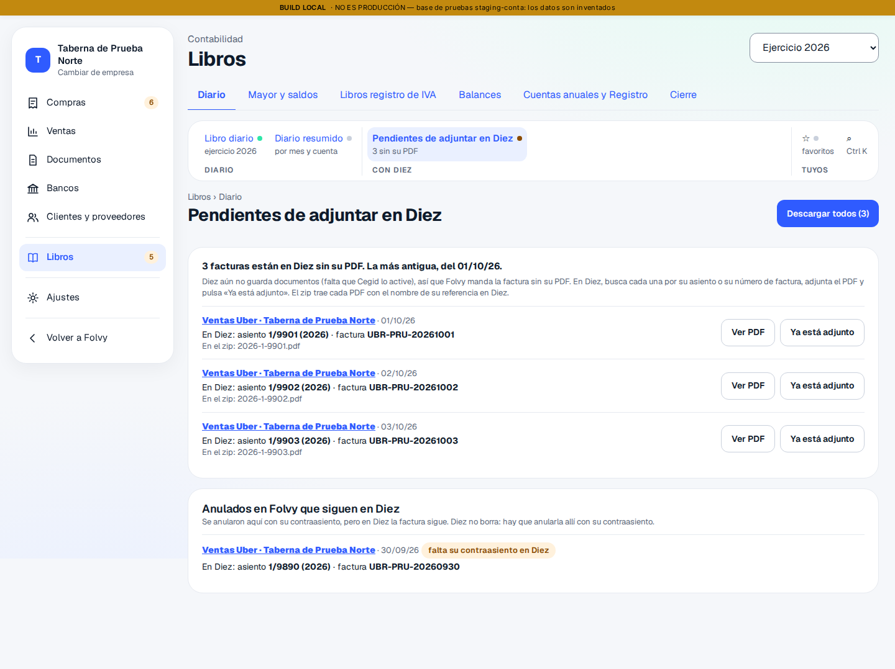
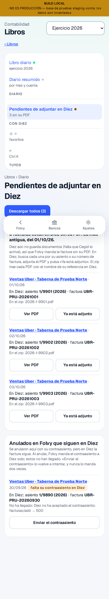

# C06b · Respuesta 8 de Julio — validar con el PDF, y anular también en Diez

Rama `conta/c06b-validar-pdf` (sale de la #185 fusionada). **Nada en
producción**: la tanda de la 0720 está preparada y sin lanzar (§3), y no hay
PR a `main`.

> «1. Sí: validar y generar el PDF van juntos; si falla el PDF, el asiento no
> se valida y se dice por qué. 2. Sí: al anular un asiento ya enviado, Folvy
> manda el contraasiento a Diez solo, con el mismo control de "nunca dos
> veces".»

## 1 · Validar y guardar el PDF van juntos

**Cómo.** El PDF lleva el número del asiento, y ese número es el siguiente
de su serie en el ejercicio (`max + 1`, en `journal_entry_validar`). Así que
se sabe antes de validar:

1. `conta_numero_previsto(asiento)`: el número que le tocaría ahora.
2. El navegador hace el «Resumen de ventas» **con ese número** y lo sube.
3. `journal_entry_validar_con_documento`: valida y guarda el PDF **en una
   transacción**. Si el número que da la validación no es el del PDF (otro
   asiento de la serie se ha validado entre medias) o el PDF no se puede
   guardar, no se valida nada.

Si el PDF no se puede hacer (la empresa sin NIF, el asiento sin local…), no
se llega al paso 3. Si otro se cuela entre medias, se repite **una** vez con
el número nuevo; si vuelve a pasar, para y lo dice.

**Por ningún otro camino.** Un disparador **diferido** en `journal_entry`
mira al cerrar la transacción que un asiento de ventas de una plataforma no
queda validado sin su PDF. Cubre el botón de antes en una pestaña sin
recargar y cualquier llamada directa. Los demás asientos (manuales, compras,
banco) y el contraasiento de una anulación validan como siempre.

**Lo que se ve** (números de ejemplo). En el asiento: «Validado: Ventas nº 1.802, encadenado con
su huella… Con su «Resumen de ventas» guardado en Folvy; aún no se ha
enviado a Diez.» Y si falla: «No se ha validado: su PDF no se puede hacer
(la empresa no tiene nombre o NIF…). Validar y guardar su PDF van juntos: sin
su PDF, el asiento sigue sin validar.» Lo mismo en «Validar y enviar a Diez».

**Comprobado en staging** (run 38611777245, prueba
`supabase/staging/sql/20261111_c06b_validar_con_pdf_prueba.sql`, en
transacción con rollback), tal cual:

```
PRUEBA C06b · 0: dos funciones y el disparador diferido: ok.
PRUEBA C06b · prep: el 18/09 de Glovo de A, propuesto.
PRUEBA C06b · 1: validar a secas no valida («Un asiento de ventas de una plataforma se valida con su PDF («Resumen de ventas»), y este no lo lleva: no se v»); sigue propuesto y le toca el nº 2.
PRUEBA C06b · 2: PDF de otro número → no se valida («El PDF se hizo con el nº 3 y al validar le toca el nº 2 (se ha validado otro asiento de la serie a la vez): no se valida»).
PRUEBA C06b · 3: sin el PDF subido → no se valida («El documento no está subido (c01a0000-…/6e16fd89-…») y le sigue tocando el nº 2.
PRUEBA C06b · 4: validado nº 2 con su PDF en la misma transacción; el disparador lo deja pasar.
PRUEBA C06b · 5: anulado; su contraasiento (nº 3) validado sin PDF propio.
PRUEBA C06b · 6: un asiento manual se valida sin PDF, como siempre.
PRUEBA C06b · 7: B ni ve el número previsto ni valida lo de A («Solo un administrador o un encargado de la cuenta valida asientos.»).
```

Y en pruebas unitarias (`tests/unit/modules/conta/validarConPdfC06b.test.ts`,
8): el orden, que sin PDF no se llama a validar, el reintento único, y que lo
ya validado no se toca.

**De paso, un agujero del analizador.** `analizar.mjs` no reconocía
`create constraint trigger`: el disparador de la 0720 habría pasado sin
clasificar, ni «añade» ni «cambia». Arreglado, con una prueba que falla sin
el arreglo y pasa con él.

**Ojo, staging es compartido:** la 0720 está aplicada allí. Una prueba de otro
frente que valide (y confirme) un asiento de plataforma por RPC sin su PDF
ahora la rechaza la base. Las que validan dentro de una transacción con
rollback no lo notan (el disparador mira al confirmar).

## 2 · Anular lo que ya está en Diez: el contraasiento va solo

**Primero se midió cómo lo hace la gestoría.** El Swagger de apiCON tiene
los campos de rectificativa (`TipoRectificativa` 1|2,
`NumeroFacturaRectificativa`, `FechaFacturaRectificativa`,
`TotalBasesRectificativa`, `TotalCuotasRectificativa`) pero no dice qué
lleva cada uno. Lectura de la C0009, solo GET y `escribir: false`
(`scripts/conta/diez/prueba-c0009-rectificativas-molde.ts`, run
38615160577):

```
- Meses 202301–202610 (46 de 46): 6820 facturas emitidas distintas (sin contestar: ninguno).
- Con algo de rectificativa: 3
- Con el total en negativo: 143 (de ellas, con algo de rectificativa: 3)
| Serie | "2" 141 · "1" 2 |
| TipoFactura | 1 143 |
| ClaveTipoFactura | null 143 |
| TipoRectificativa | 0 143 |
- Serie 2 · cuenta 410… · nº `F999999999-ANUL` · rectifica — · base − cuota − total − · descripción `ANUL DUPLICADO F999999999 (asto 9/999)`
- Serie 1 · cuenta 430… · nº `GLV999999-99999999` · rectifica — · base − cuota − total − · apuntes 708(−)
Peticiones: 68 · 429: 0
```

O sea: la anulación que hay va con el número de la original y **«-ANUL»**,
la descripción empieza por **«ANUL»**, importes en negativo, `TipoFactura`
1 y **ningún campo de rectificativa**. Y en la serie 1 ninguna lleva
`TipoRectificativa` (0 en las 143 negativas). Folvy hace lo mismo y no
rellena ninguno: había supuesto `TipoRectificativa: 2` y la lectura lo
desmintió, así que está quitado.

**La factura que anula** (`facturaQueAnula`, `_shared/diezFactura.ts`): la
de lo anulado, rehecha de sus mismas líneas, con todos los importes en
negativo (base, cuota, total, cada línea y su analítica al otro lado), la
fecha del contraasiento, `UBR-FLO-20261001-ANUL` y «ANUL UBER EATS FLO
01/10». Si la rehecha no tiene el número que está en Diez, no anula a ciegas.

**Los frenos, los de la factura** (`enviarContraasientoADiez`,
`_shared/diezEnviar.ts`), con su propio envío en `external_send` (el del
contraasiento de Folvy, un envío por asiento):

1. Solo el contraasiento validado de una anulación, y solo si lo anulado
   está en Diez. Si no llegó, allí no hay nada que anular: no se escribe nada.
2. C0001 nunca. Diez real solo con lo autorizado: la empresa, el
   contraasiento **o el asiento que anula** (§5, pregunta 1).
3. Nunca dos veces: ya enviado → no habla con Diez («Ya estaba anulada en
   Diez: 1/1801, con 1/1802.»); ya en Diez con ese número → se enlaza; dos →
   no se toca. La intención se apunta antes de escribir.
4. Como mucho 3 intentos.

Sin PDF: el contraasiento no es un resumen de ventas (§5, pregunta 2).

**Cuándo.** Al pulsar «Anular» en el asiento (o «Deshacer» en «Lo que he
hecho yo»), si su factura está en Diez, el Libro llama solo a
`conta-diez-enviar` con el id del contraasiento. La pantalla lo dice (ejemplo):
«Anulado. Contraasiento Ventas nº 1.290 del 14/10, enlazado con este. Anulada
también en Diez: 1/1801 (UBR-FLO-20261001) con 1/1802
(UBR-FLO-20261001-ANUL).» Si no llega, lo dice y queda en **Pendientes de
adjuntar en Diez › Anulados que siguen en Diez**, con el motivo y **«Enviar el
contraasiento»**. Una vez en Diez, el asiento dice «Anulado en Folvy y en
Diez · 1/1801 anulada con 1/1802» y sale de esa lista.

**Comprobado:** 9 pruebas en `tests/conta/diez/enviar.test.ts` (la forma,
sin campos de rectificativa; lo no enviado no se anula; nunca dos veces de
las tres maneras; anular a ciegas no; C0001, Diez real y lo autorizado;
Diez que no acepta) y 1 del estado en `pendientesDiezC06b.test.ts`.
`conta-diez-enviar` desplegada en staging (run 38617077453). **No se ha
escrito ningún contraasiento en Diez**, tampoco en la C0009: la primera
escritura real de una anulación la decide Julio.

## 3 · La tanda de producción (preparada, NO lanzada)

`supabase/produccion/aplicar.txt`: solo la 0720. Su cuenta,
`scripts/conta/produccion/cuentas/validar-con-pdf.sql`; su vuelta atrás, la
`.down.sql` (fuera el disparador y las tres funciones; no toca asientos ni
documentos).

Contexto medido en producción en solo lectura el 14/10 a las 18:41 UTC:
`journal_entry` existe (14 955 filas), fuera del camino del pedido; las tres
funciones no existen; la 0720 no está en el historial. El analizador:

```
### supabase/migrations/20261111T0720_c06b_validar_con_pdf.sql — sigue
- Crea (nuevo): funcion public.conta_numero_previsto(uuid), funcion public.journal_entry_validar_con_documento(uuid,integer,text,text,text,integer,text), funcion public.journal_entry_valida_con_pdf()
- cambia · crea · disparador · public.journal_entry · trg_journal_entry_valida_con_pdf — disparador nuevo en una tabla que existe: cambia cómo se escribe en ella · 14955 filas · bloqueo SHARE ROW EXCLUSIVE
  - declarado, prueba supabase/staging/sql/20261111_c06b_validar_con_pdf_prueba.sql
autorizo: (ninguno)
```

## 4 · El orden

1. La tanda (ensayo y real), **antes** de fusionar: el front nuevo llama a
   las dos funciones.
2. PR a `main` y fusión; Vercel READY.
3. Desplegar `conta-diez-enviar` (el contraasiento).

Entre el 1 y el 2, quien valide un asiento de plataforma con el front de
antes verá «se valida con su PDF» y no validará: es lo pedido, y se arregla
recargando con el front nuevo.

## 5 · Lo que he decidido yo y Julio tiene que confirmar

1. **Lo autorizado para escribir una factura en Diez real también vale para
   anularla.** Con el asiento de Uber · Alcalá autorizado en C0008, su
   anulación entraría en C0008 sin otra autorización. ¿Vale, o la anulación
   pide su propio «autorizo»?
2. **El contraasiento va a Diez sin PDF.** No es un resumen de ventas y no
   tiene documento propio. ¿Vale, o quieres un PDF de la anulación?
3. **El número de la anulación es el de la original con «-ANUL»**, como el
   único caso que hay en la C0009 (uno, y de compras). Si la gestoría
   prefiere otro, se cambia en un sitio (`FORMA_ANULACION`).

## 6 · Diseño

Capturas de la e2e del frente, en `docs/conta/capturas/c06b/`. La pantalla de
pendientes, ya con un anulado cuyo contraasiento no ha llegado (su motivo y
«Enviar el contraasiento»):

| Ordenador | Móvil |
|---|---|
|  |  |
