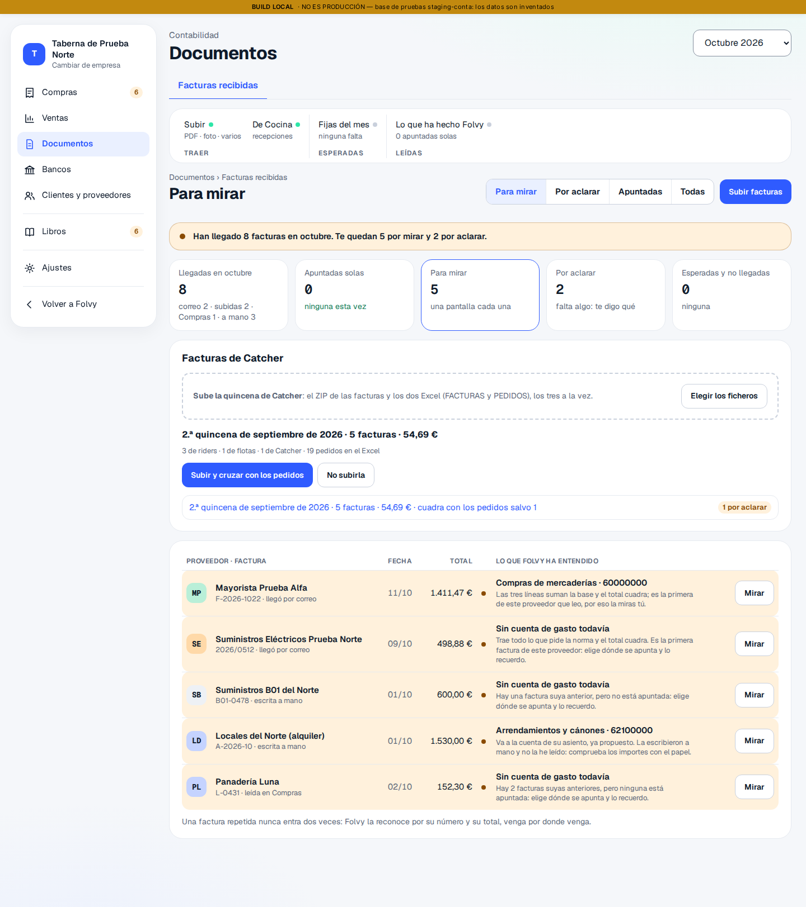
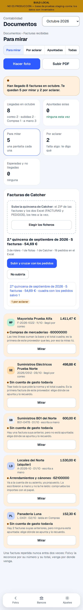
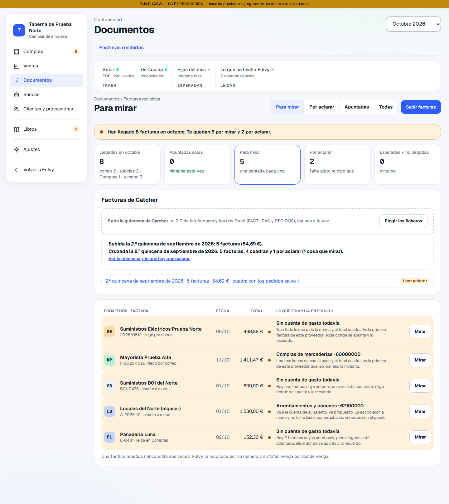
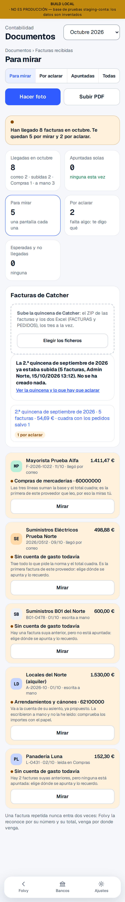
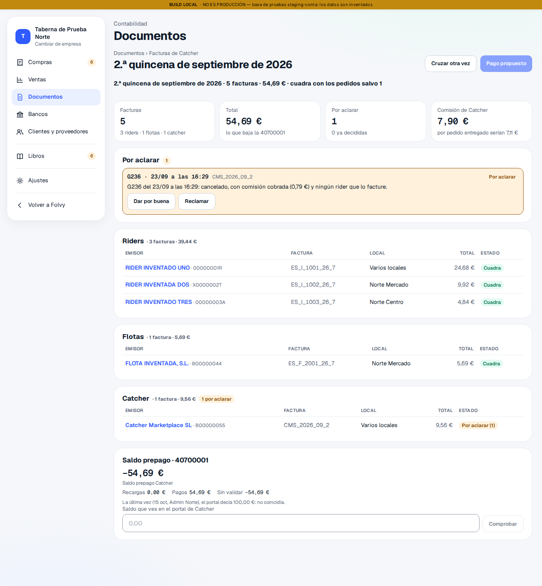
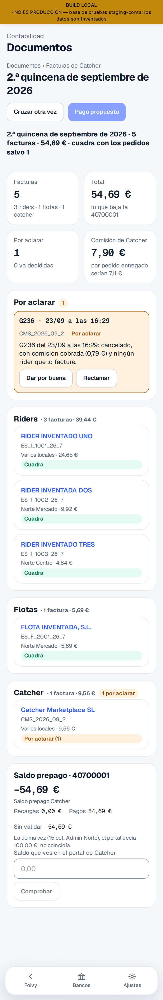
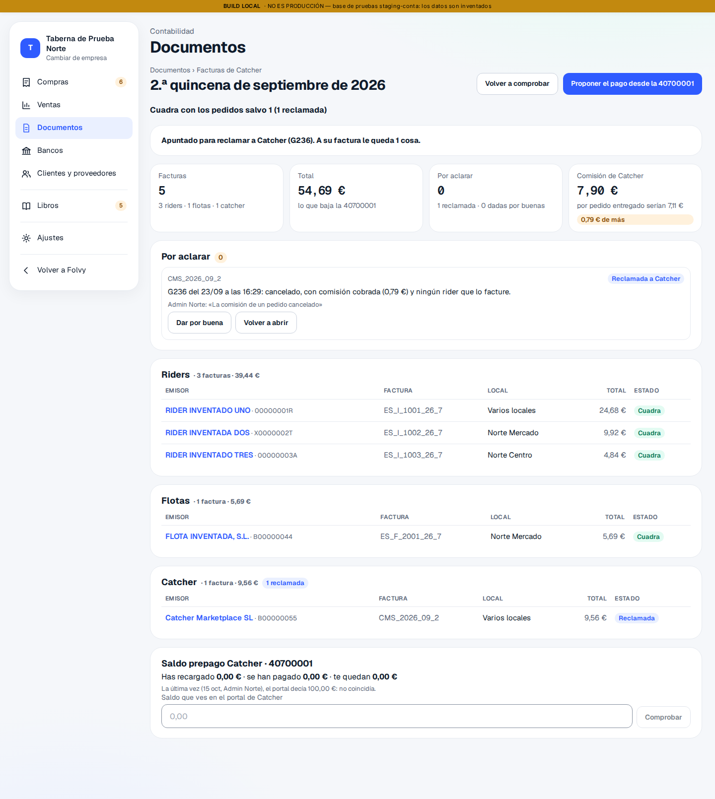
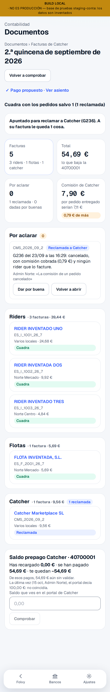
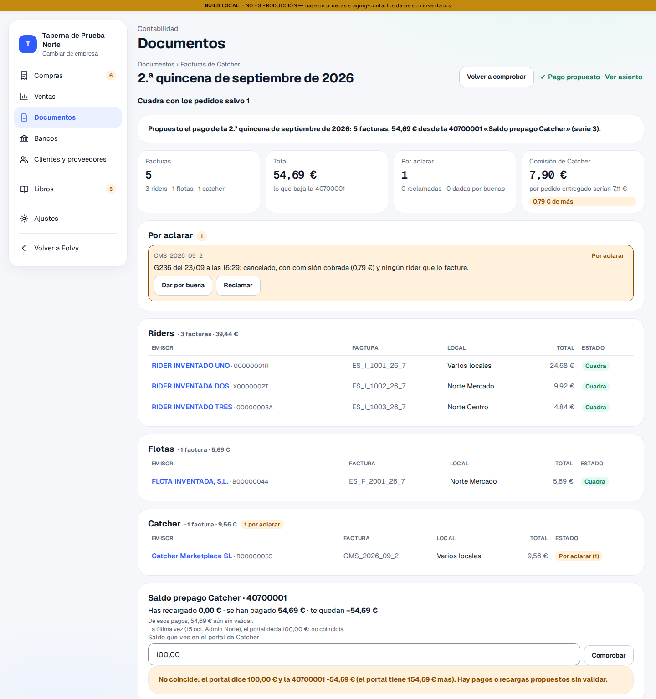
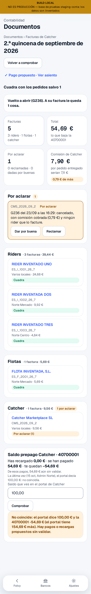

# E05 · Facturas de riders de Catcher · informe

Rama `conta/d01-catcher`. Frente A. Todo lo de este informe son recuentos, códigos y el ejemplo inventado: ni un nombre, NIF o NIE de un rider (RGPD).

## Qué hace

Cada quincena, Catcher da unas 58 facturas a nombre de Llorente29 Food: las de los riders, las de las flotas y la suya de comisión. Hoy se meten a mano. Ahora:

1. **Se arrastran juntos** el ZIP de PDF y los dos Excel (FACTURAS y PEDIDOS) en Documentos.
   - Se reconoce cada fichero por lo que lleva dentro y de qué quincena es.
   - Lo leído se enseña en una línea antes de subir nada.
   - La misma quincena dos veces no crea nada y lo dice.
2. **Una factura recibida por PDF**, con su PDF guardado:
   - emisor, NIF o NIE, fecha, base, IVA del 21 % y total, sacados del Excel (no leídos con IA) y comprobados contra el texto del PDF;
   - el local, según la tienda de Catcher;
   - riders y flotas al proveedor genérico «Riders» (41000100), con el emisor en cada factura, que es lo que va a Diez; la comisión, al acreedor de Catcher (si no tiene ficha, se propone darla de alta);
   - lo que ya está en Diez se enlaza, no se duplica (la búsqueda del #190; en septiembre, 141 de 141).
3. **Los cruces**, antes de dar nada por bueno:
   - pedido a pedido con lo que se mandó a Catcher, por código más fecha y hora;
   - el precio de cada pedido contra el que dio Catcher al mandarlo o, si no lo dio, contra la tarifa fechada;
   - 0,79 € de comisión por pedido entregado;
   - los totales: los pedidos suman cada factura, el Excel suma el lote y el pago baja de la 40700001 lo mismo.
   - Lo que cuadra, seguro. Lo que no, «Por aclarar», con el pedido y el porqué.
4. **El pago**: un asiento propuesto por quincena en la serie de tesorería, contra la 40700001 «Saldo prepago Catcher».
5. **El saldo prepago**, en la ficha de Catcher y en la quincena. Si se escribe el saldo del portal, dice si coincide y cuánto no.
6. **El coste de reparto** por local, marca y plataforma, del cruce con los pedidos (queda en el resumen del cruce de cada quincena).

Lo que no hace: no manda nada a Diez. Las recibidas siguen cerradas (`incluye_recibidas = false`) hasta que Julio diga.

## Diseño

Sin maqueta nueva: va dentro de Documentos (N22), con sus piezas y su estilo (`documentos.css`, clases `cxk-*` hechas solo con tokens).

### En Documentos: «Sube la quincena de Catcher»

- **Zona de arrastre**: la de Compras (`cxc-soltar`), con «Elegir los ficheros» para quien no arrastra. Admite los tres a la vez.
- **Lo leído, antes de subir**: «2.ª quincena de septiembre de 2026 · 5 facturas · 54,69 €», con cuántas de riders, de flotas y de Catcher y cuántos pedidos trae el Excel.
  - Lo que impide subirla (un fichero que falta, periodos mezclados) se dice y el botón no se puede pulsar.
  - Lo que no cuadra en una factura sube igual y queda por aclarar.
- **«Subir y cruzar con los pedidos»**: dice lo que ha hecho. Por ejemplo: «Subida la 2.ª quincena…: 5 facturas (54,69 €).» y «Cruzada…: 5 facturas, 4 cuadran y 1 por aclarar (1 cosa que mirar).»
- **Debajo, las quincenas subidas**: una línea cada una, con su contador. Por ejemplo: «2.ª quincena de septiembre de 2026 · 5 facturas · 54,69 € · cuadra con los pedidos salvo 1».

| Ordenador | Móvil |
|---|---|
|  |  |
|  |  |

### La quincena (`/conta/documentos/catcher/:lote`)

- **Arriba**: el resumen en una línea y cuatro cifras.
  - Facturas, por grupo.
  - Total («lo que baja la 40700001»).
  - Por aclarar, y cuántas ya están decididas.
  - La comisión cobrada, frente a la que saldría por pedido entregado.
- **«Por aclarar»**, cada cosa con:
  - su pedido (código y hora de Madrid) y su factura;
  - el porqué, en una frase con el importe;
  - los botones «Dar por buena», «Reclamar» (pide qué se reclama) y «Volver a abrir».
  - Lo decidido no desaparece: se queda abajo, con quién lo decidió y su nota (regla 7).
- **Las facturas, por riders, flotas y Catcher**: cada grupo con su número, su total y su contador «N por aclarar».
  - Cada factura, con su emisor, número, local («Varios locales» si reparte) y estado.
  - Cada una lleva a Revisar factura (N23).
- **«Proponer el pago desde la 40700001»** (una vez; luego dice «Pago propuesto») y **«Cruzar otra vez»**.
- **El saldo prepago**: ver abajo.

| Ordenador | Móvil |
|---|---|
|  |  |
|  |  |

### El saldo prepago (en la quincena y en la ficha de Catcher)

- **El saldo de la 40700001**, recargas menos pagos, con lo que está sin validar aparte.
- **La última comparación con el portal**, si la hay.
- **La casilla «Saldo que ves en el portal de Catcher»** con «Comprobar». Contesta, por ejemplo: «No coincide: el portal dice 100,00 € y la 40700001 −54,69 € (el portal tiene 154,69 € más). Hay pagos o recargas propuestos sin validar.»

| Ordenador | Móvil |
|---|---|
|  |  |

En el móvil, las filas de las facturas son tarjetas, las cifras van de dos en dos y los botones bajan debajo de cada cosa por aclarar.

Las capturas son de staging con la quincena inventada de `tests/conta/e05/ejemplo.ts`, que tiene la misma forma que los ficheros reales: tres riders, una flota, la comisión y el G236 cancelado.
- **Los pedidos de la app los pone la prueba.** Staging no tiene ventas de Catcher, y crearlas dispararía el despacho y la impresión, porque `sale` tiene esos disparadores y staging es compartido. Se intercepta solo esa lectura (`conta_lote_pedidos_app`).
- **Lo demás es la base de staging**: subir, cruzar, decidir, pagar y comprobar el saldo.

## Norma

- **RD 1619/2012, art. 6.** Se comprueba en cada factura con lo del Excel: número, fecha de expedición, nombre y NIF del emisor y del destinatario (y que el destinatario es esta empresa), domicilios, fecha de las operaciones (el ejercicio), tipo (21 %), cuota y que base + cuota = total. El NIF o NIE del emisor, con forma válida.
- **Ley 37/1992, art. 97.** Solo se deduce el IVA soportado con factura válida. Por eso una factura que no cumple, o cuyo PDF no dice lo mismo que el Excel, no se propone como segura.
- **PGC** (RD 1515/2007, plan de pymes; texto en `docs/conta/fuentes/textos/rd-1515-2007.txt`):
  - **407. Anticipos a proveedores.** «Entregas a proveedores, normalmente en efectivo, en concepto de «a cuenta» de suministros futuros.» «Figurará en el activo corriente del balance, en el epígrafe «Existencias».»
  - **410. Acreedores por prestaciones de servicios.** «Deudas con suministradores de servicios que no tienen la condición estricta de proveedores.» «Se abonará: a1) Por la recepción «a conformidad» de los servicios, con cargo, generalmente, a cuentas del subgrupo 62.»
  - **624. Transportes.** «Transportes a cargo de la empresa realizados por terceros, cuando no proceda incluirlos en el precio de adquisición del inmovilizado o de las existencias. En esta cuenta se registrarán, entre otros, los transportes de ventas.»
  - **Una observación**, no un cambio: la 407 habla de «suministros futuros» y va en «Existencias». El saldo prepago de Catcher es para servicios de transporte. La cuenta la eligió la gestoría en Diez (la 40700001) y así se usa. Si en el cierre conviene otra presentación en el balance, es una pregunta para la gestoría.
- **RGPD.** Nombres, NIF o NIE y domicilios de los riders solo en producción. Ni en el repositorio, ni en staging, ni en los logs: los workflows solo sacan recuentos.

## Contraste

Cómo lo resuelven con un proveedor que factura en lote. Lo que no está en su documentación pública se dice así, no se supone.

**1 · Subir la quincena (los ficheros del portal)**

| | Comparado con esto |
|---|---|
| Holded | Por debajo. Su ayuda pública tiene importación por Excel de productos; no encontré importación en lote de facturas de compra desde un ZIP y un Excel. |
| Pennylane | Igual. Arrastrar varios ficheros, correo, conectores de portales de proveedores (Amazon Business, Cdiscount Pro…) e importación de asientos en Excel o CSV. No lee un ZIP más dos Excel de un mismo portal como un lote. |
| Diez | Por debajo. Sin importación en lote de recibidas: hoy se meten a mano (1.018 de 1.572 de junio a septiembre son de riders). Hay terceros con OCR (Inmatic). |

**2 · Una factura por PDF, con el emisor y sin leer con IA**

| | Comparado con esto |
|---|---|
| Holded | Por debajo. OCR factura a factura; un emisor distinto por factura en un mismo proveedor no está documentado. |
| Pennylane | Por debajo. OCR por documento; su propia documentación avisa de que lee mal los resúmenes de varias facturas. Con Excel, cada fila es una pieza, pero sin cruzarla con su PDF. |
| Diez | Igual en el resultado (CifCliente por factura en la 41000100), por debajo en el trabajo: a mano. |

**3 · Cruce con los pedidos, la tarifa y la comisión**

| | Comparado con esto |
|---|---|
| Holded | Por debajo: no está documentado. |
| Pennylane | Por debajo: concilia factura con pago, no factura con pedidos. |
| Diez | Por debajo: no lo hace. |

**4 · «Por aclarar», con el pedido y el porqué**

| | Comparado con esto |
|---|---|
| Holded | Por debajo: avisos de factura duplicada, no por pedido. |
| Pennylane | Por debajo: estados por documento («à justifier»), no por pedido. |
| Diez | Por debajo: no lo hace. |

**5 · El pago contra un saldo prepago y su comparación con el portal**

| | Comparado con esto |
|---|---|
| Holded | Por debajo: el pago se concilia contra el banco; un anticipo se compensa a mano. |
| Pennylane | Por debajo: igual, conciliación bancaria; no compara con el saldo de un portal. |
| Diez | Por debajo: el asiento de pago contra la 40700001 se hace a mano, factura a factura. |

Fuentes:
- [Pennylane · gestión de compras](https://www.pennylane.com/fr/gestion-achats)
- [Pennylane · todas las funciones](https://www.pennylane.com/fr/toutes-nos-fonctionnalites)
- [Importar en lote facturas de proveedores en Pennylane](https://invoicedataextraction.com/blog/importer-factures-fournisseurs-lot-pennylane-batch-excel)
- [Holded · importar productos mediante Excel](https://intercom.help/holded/es/articles/6909161-importar-productos-mediante-excel)
- [Inmatic con Cegid Diez (DiezCON / ERPDiez)](https://inmatic.ai/compatibilidad/cegid-diez-diezcon-erpdiez)

## Pruebas

- **Núcleo** (`tests/conta/e05`): 36 pruebas.
  - La lectura de los tres ficheros (con PDF de verdad, hechos con jspdf y leídos con pdfjs), la norma, el PDF contra el Excel y las horas de Madrid a UTC.
  - Los cruces, con el caso real G236 y cada cosa que puede no cuadrar.
  - La tarifa fechada, el resumen de cada quincena y el reparto entre tiendas.
- **Staging**, cada una en una transacción con rollback:
  - lotes: run 38721271856;
  - cruces: run 38713804585;
  - pago y saldo: run 38716016949;
  - la semilla de la e2e: run 38721271856.
- **e2e** (`tests/e2e/conta/d01/catcher.spec.ts`): ordenador y móvil; ver el PR.

## La tanda de producción (preparada, no lanzada)

- **Manifiesto:** `tests/conta/produccion/tanda-e05-catcher-20261015.txt`. Para lanzarla se copia a `supabase/produccion/aplicar.txt` cuando Julio diga: el manifiesto vivo es de B y va antes.
- **Ficheros**, en orden: 0100, 0110, 0120, 0130 y 0140 (los datos de Foodint):
  - la 40700001 «Saldo prepago Catcher», colgada de la 407;
  - la 62400001 como gasto de «Riders»;
  - las tiendas → local: Camichi → Carabanchel, Florencio Llorente → Alcalá;
  - la tarifa desde el 01/09/2026.
- **Analizador**, con el contexto de producción medido en solo lectura (`contexto-produccion-e05-catcher-20261015.json`): las cinco, «sigue»; «autorizo», ninguno. Ninguna está en el camino del pedido.
- **Vuelta atrás:** `tests/conta/produccion/vuelta-atras-e05-catcher-20261015.txt`. Cada fichero para, sin tocar nada, si ya hay algo que se perdería.

## Lo que queda

- **Catcher sin ficha en producción.** La primera quincena propone su alta; su 410 se le pone en la ficha antes de proponer el pago (si no, el pago para y dice cuál falta). Diez tiene a Catcher en una 410 (12 facturas de junio a octubre).
- **Con el primer Excel real:** comprobar que `transport_price` es la base sin IVA y que los nombres de las columnas son los del doc. Si algo no cuadra, se para y se dice.
- **Las recibidas a Diez**, cuando Julio abra `incluye_recibidas`.
